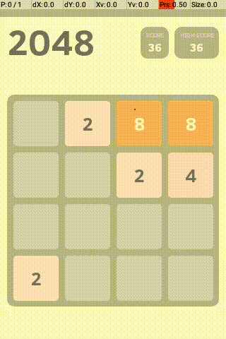

# AndroidEnv - Architecture & Environment Features

AndroidEnv exposes an Android device—either an Android Studio Emulator or a
physical hardware device—through a decoupled, two-layer architecture designed
for both **direct UI agent control (`AndroidDevice`)** and **Reinforcement
Learning (`AndroidEnv` + `TaskWrapper`)**.

> Migrating from AndroidEnv v1? See the
> [AndroidDevice (v2) Migration Guide](migrating_to_android_device.md).

## 1. Decoupled Architecture

In AndroidEnv v2, raw device telemetry and action injection are separated from
Reinforcement Learning task semantics:

```
+-----------------------------------------------------------------------+
| Host (Python)                                                         |
|                                                                       |
|  +---------------------------+    +--------------------------------+  |
|  | UI Agent / Test Harness / |    | RL Agent (dm_env / Gymnasium)  |  |
|  | AndroidEnv Playground     |    +---------------+----------------+  |
|  +-------------+-------------+                    |                   |
|                |                   +--------------v----------------+  |
|                |                   | TaskWrapper & RL Wrappers     |  |
|                |                   | (android_env.rl.environment)  |  |
|                |                   +--------------+----------------+  |
|                |                                  |                   |
|                +-----------------+----------------+                   |
|                                  |                                    |
|                                  v                                    |
|                    +---------------------------+                      |
|                    |       AndroidDevice       |                      |
|                    |  (WebSocket + ADB Client) |                      |
|                    +-------------+-------------+                      |
+----------------------------------|------------------------------------+
                                   | WebSockets (Protobuf) & ADB
+----------------------------------v------------------------------------+
| Android Device (Emulator or Physical Hardware)                        |
|                                                                       |
|                    +---------------------------+                      |
|                    |  AndroidEnv Kotlin Core   |                      |
|                    | (com.google.androidenv)   |                      |
|                    +-------------+-------------+                      |
|                                  |                                    |
|      +---------------------------+---------------------------+        |
|      v                           v                           v        |
| MediaProjection          AccessibilityService        SensorManager /  |
| (Screenshots)            (UI Tree & Actions)         Logcat / Audio   |
+-----------------------------------------------------------------------+
```

### Real-time Execution

Android devices run in real time independently of the host agent. The operating
system does not pause between observations or wait for agent deliberation. This
makes Android interaction similar to real-world robotics, where agents must
handle asynchronous UI animations, network loading states, and timing-sensitive
gestures.

--------------------------------------------------------------------------------

## 2. Telemetry Signals (`DeviceState`)

When interacting with `AndroidDevice`, calling `device.get_state()` returns a
`DeviceState` protobuf containing the device orientation, snapshot timestamp,
and a list of `StreamedSignal` messages for all active subscriptions.

Clients can dynamically configure which signals the on-device server captures
using `device.update_subscriptions({...})`:

*   **`DEVICE_SIGNAL_SCREENSHOT`** (`screenshot.decoded`): Uncompressed RGB
    pixel bytes (`raw_pixels`, `width`, `height`).
*   **`DEVICE_SIGNAL_ACCESSIBILITY_TREE`** (`accessibility_forest`): Full UI
    hierarchy (`AndroidAccessibilityForest`) across active windows.
*   **`DEVICE_SIGNAL_ACCESSIBILITY_EVENTS`** (`accessibility_events`): Stream of
    UI accessibility events triggered on the device.
*   **`DEVICE_SIGNAL_ACTIVE_PACKAGE`** (`active_package`): Package name of the
    current foreground application.
*   **`DEVICE_SIGNAL_ACTIVE_ACTIVITY`** (`active_activity`): Class name of the
    current foreground activity.
*   **`DEVICE_SIGNAL_SYSTEM_LOGS`** (`system_logs`): Recent `logcat` lines
    captured on the device.
*   **`DEVICE_SIGNAL_RUNNING_PROCESSES`** (`running_processes`): List of active
    process names.
*   **`DEVICE_SIGNAL_DEVICE_SETTINGS`** (`device_settings`): Map of system
    settings (e.g., brightness, volume).
*   **`DEVICE_SIGNAL_LOCATION_GPS`** (`location_gps`): Latitude, longitude, and
    altitude coordinates.
*   **`DEVICE_SIGNAL_AUDIO_OUTPUT`** (`audio_output`): PCM audio frames captured
    from device output.
*   **`DEVICE_SIGNAL_SENSOR_*`** (`accelerometer`, `gyroscope`, `magnetometer`,
    `barometer`, `ambient_temp`, `light_level`, `proximity`, `heart_rate`):
    Hardware sensor streams.

--------------------------------------------------------------------------------

## 3. Action Space (`Action`)



Agents control the device by passing `device_env_service_pb2.Action` protobufs
to `device.send_action(action)`:

*   **Touch & Multi-Touch (`ACTION_TYPE_TOUCH_DOWN`, `ACTION_TYPE_TOUCH_MOVE`,
    `ACTION_TYPE_TOUCH_UP`)**:
    *   `touch_position`: Normalized `Point(x, y)` coordinates in `[0.0, 1.0]`
        where `(0.0, 0.0)` is the top-left corner and `(1.0, 1.0)` is the
        bottom-right corner.
    *   `pointer_id`: Optional finger index in `[0, 9]` (defaults to `0`),
        enabling multi-touch gestures such as pinch-to-zoom and two-finger
        rotations.
*   **Hardware Keys (`ACTION_TYPE_KEY_EVENT`)**:
    *   `keycode`: Standard Android `KeyEvent` integer (e.g., `4` for `BACK`,
        `3` for `HOME`, `66` for `ENTER`).
*   **Native Accessibility Text & Clipboard (`ACTION_TYPE_SET_TEXT`,
    `ACTION_TYPE_SET_SELECTION`, `ACTION_TYPE_CUT`, `ACTION_TYPE_COPY`,
    `ACTION_TYPE_PASTE`)**:
    *   Directly inserts text or manipulates selection on the focused input node
        via Android's `AccessibilityNodeInfo` without needing virtual keyboard
        taps.

### Composable Touchscreen Gestures

Individual touch events compose naturally into human touchscreen gestures
depending on their trajectory and timing:

| Tap                                      | Double Tap                                             | Touch & Hold                                             | Flick Left                                             | Flick Right                                              | Scroll (H)                                                           | Scroll (V)                                                       | Drag & Drop                                |
| ---------------------------------------- | ------------------------------------------------------ | -------------------------------------------------------- | ------------------------------------------------------ | -------------------------------------------------------- | -------------------------------------------------------------------- | ---------------------------------------------------------------- | ------------------------------------------ |
|  : 'double_tap'](images/gestures/1-Finger-Double-Tap.gif) : 'touch_hold'](images/gestures/1-Finger-Touch-&-Hold.gif) : 'flick_left'](images/gestures/1-Finger-Flick-Left.gif) : 'flick_right'](images/gestures/1-Finger-Flick-Right.gif) : 'horizontal_scroll'](images/gestures/1-Finger-Horizontal-Scroll.gif) : 'vertical_scroll'](images/gestures/1-Finger-Vertical-Scroll.gif) : 'move'](images/gestures/1-Finger-Move.gif) :

--------------------------------------------------------------------------------

## 4. Reinforcement Learning Layer (`android_env.rl`)

For Reinforcement Learning workloads that require a standard
[`dm_env.Environment`](https://github.com/google-deepmind/dm_env) loop
(`reset()`, `step(action)`), `android_env.rl.environment.AndroidEnv` adapts an
`AndroidDevice` into array-based observation and action specs:

*   **Observations**: A dictionary containing:
    *   `'pixels'`: `(H, W, 3)` `uint8` RGB image array.
    *   `'timedelta'`: `int64` microseconds elapsed since the previous timestep.
    *   `'orientation'`: `(4,)` `uint8` one-hot vector representing device
        rotation.
    *   `'active_package'`: Foreground application package string returned on
        each `reset()` / `step()` transition (along with optional `'audio'`
        `(N, 2)` `int16` PCM frames when `DEVICE_SIGNAL_AUDIO_OUTPUT` is
        subscribed).
*   **Action Spec**: A dictionary containing:
    *   `'action_type'`: Discrete `ActionType` value (`TOUCH`, `LIFT`, `REPEAT`,
        `KEYDOWN`, `KEYUP`, plus accessibility `TEXT`, `SET_SELECTION`, `CUT`,
        `COPY`, `PASTE`).
    *   `'touch_position'`: Continuous `[x, y]` float array in `[0.0, 1.0]`.
    *   `'keycode'`: Android `KeyEvent` integer (used with `KEYDOWN`; optional
        `'text'` and `'selection'` keys are also accepted by `step()` for
        accessibility actions).
*   **Telemetry & Task Extras (`env.task_extras()`)**: Exposes structured
    signals (`'accessibility_tree'`, `'logs'`, `'accessibility_events'`,
    `'battery_power'`) and custom app log extras parsed by `TaskWrapper` (see
    the [Tasks guide](tasks_guide.md)).

### RL Environment Wrappers

AndroidEnv includes composable wrappers under `android_env/wrappers/` to adapt
the `dm_env` interface for different RL algorithms:

*   `TaskWrapper`: Layers a `Task` `.textproto` definition (setup/reset ADB
    steps, logcat reward regexes, and episode termination criteria) on top of
    `AndroidEnv`.
*   `DiscreteActionWrapper`: Discretizes the continuous `(x, y)` touch space
    into an `N x K` grid.
*   `TapActionWrapper`: Converts single actions into multi-frame tap-and-lift
    sequences.
*   `ImageRescaleWrapper`: Resizes pixel observations or converts them to
    grayscale.
*   `FloatPixelsWrapper`: Normalizes pixel values from `[0, 255]` (`uint8`) to
    `[0.0, 1.0]` (`float32`).
*   `FlatInterfaceWrapper`: Flattens dictionary observations and actions into a
    single array/scalar.
*   `GymWrapper`: Adapts the `dm_env.Environment` interface to Gymnasium.
